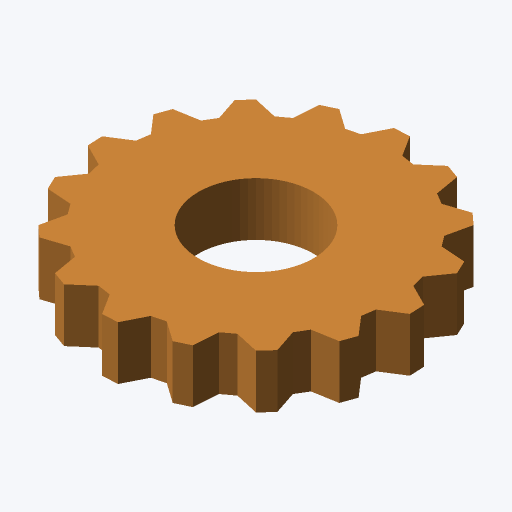

# Catwalk

Turn 3D models into PNG thumbnails from the command line or a Rust application. Catwalk renders on the CPU with automatic framing, a fixed isometric view, simple lighting and antialiasing. It runs headlessly on Linux, macOS and Windows.

The Rust crate is **`catwalk3d`**; the command is **`catwalk`**.

[Browse example thumbnails](https://cmeister2.github.io/catwalk3d/) · [Check format coverage](https://github.com/cmeister2/catwalk3d/blob/main/docs/format-coverage.md) · [Rust API reference](https://docs.rs/catwalk3d/)

## Install and make a thumbnail

Download a platform ZIP from [GitHub Releases](https://github.com/cmeister2/catwalk3d/releases), extract it, and open a terminal in the extracted directory. On Linux or macOS:

```sh
./catwalk model.stl --output thumbnail.png --size 256
```

On Windows, run `.\catwalk.exe model.stl --output thumbnail.png --size 256` in PowerShell.

Linux builds are available for x86-64 and ARM64 with GNU or musl. Choose musl for a statically linked executable, including Alpine and systems without glibc. GNU builds are compiled and tested on Ubuntu 24.04; glibc 2.39 or newer is the supported baseline. macOS builds cover Intel and Apple Silicon; Windows builds cover x86-64. The archives include license notices and release metadata, with SHA-256 checksums beside the downloads. macOS and Windows downloads are not signed or notarized.

To install with a current stable Rust toolchain and Cargo:

```sh
cargo install catwalk3d --locked
catwalk model.stl --output thumbnail.png --size 256
```

This writes a 256 × 256 PNG and fits the model into the frame. The default output is a 512 × 512 PNG on a light background.



To build from source and preview an included model:

```sh
git clone https://github.com/cmeister2/catwalk3d.git
cd catwalk3d
cargo run --release --locked -- examples/models/gear.obj --output thumbnail.png --size 256
```

The importers, renderer, compression and image codecs use Rust implementations. Running Catwalk requires no graphics driver, display server, F3D installation or subprocess converter.

## Which files can I preview?

Common inputs include:

| Family | Example extensions |
| --- | --- |
| Meshes and printable models | `.stl`, `.obj`, `.ply`, `.off`, `.3mf` |
| Scenes and animation files | `.gltf`, `.glb`, `.fbx`, `.dae`, `.3ds`, `.wrl`, `.vrml`, `.usd`, `.usda`, `.usdc`, `.usdz`, `.abc` |
| CAD, buildings and drawings | `.step`, `.stp`, `.iges`, `.igs`, `.brep`, `.xbf`, `.ifc`, `.gml`, `.dxf` |
| Point clouds | `.las`, `.laz`, `.pcd`, `.pts`, `.ptx`, `.drc`, `.slpk`, `.splat`, `.spz` |
| Scientific data | `.vtk`, `.vtp`, `.vtu`, `.vtr`, `.vti`, `.vts`, `.vtm`, `.vtkhdf`, `.exo`, `.nc`, `.nrrd`, `.mhd`, `.mha`, `.dcm` |
| Images | `.png`, `.jpg`, `.jpeg`, `.tif`, `.tiff`, `.bmp`, `.tga`, `.hdr`, `.webp`, `.exr` |

Run `catwalk --list-formats` for the complete extension list. Catwalk has readers for all 76 extension aliases in F3D 3.5's published list, plus the seven native document extensions below. **Each reader supports a documented subset; full compatibility with every file F3D can read remains unfinished.** The [coverage matrix](https://github.com/cmeister2/catwalk3d/blob/main/docs/format-coverage.md) lists supported encodings, scene features and limitations for each format.

Models use a fitted static view. Supported colors and materials are preserved; glTF/GLB and 3MF additionally support base-color textures. Animation files use a supported static pose or sample. Raster images are fitted to the canvas with their proportions preserved.

## Native documents and saved previews

Catwalk also handles these application documents:

| Document | Fresh geometry preview | Saved thumbnail |
| --- | --- | --- |
| [LightBurn `.lbrn` / `.lbrn2`](https://github.com/cmeister2/catwalk3d/blob/main/docs/format-coverage.md#lightburn) | Vector outlines in an XY plan view | PNG |
| [Blender `.blend`](https://github.com/cmeister2/catwalk3d/blob/main/docs/format-coverage.md#blender) | Stored mesh scenes, with supported object placements and instances | Embedded RGBA image |
| [AutoCAD `.dwg`](https://github.com/cmeister2/catwalk3d/blob/main/docs/format-coverage.md#autocad-drawings) | Supported drawing entities and block instances | PNG or DIB |
| [Inventor `.ipt` / `.iam`](https://github.com/cmeister2/catwalk3d/blob/main/docs/format-coverage.md#autodesk-inventor) | Unavailable | PNG or supported DIB/BMP |
| [Fusion `.f3d`](https://github.com/cmeister2/catwalk3d/blob/main/docs/format-coverage.md#autodesk-fusion) | Unavailable | Active design's saved PNG |

By default, a supported saved image is used when available. Blender, `LightBurn` and DWG fall back to their geometry readers when the saved image is missing or unreadable. A saved thumbnail can be blank or out of date.

**`LightBurn` supports fresh vector rendering:** paths, cubic Bézier curves, shared instances, nested groups, rectangles, rounded corners, ellipses and the first 16 standard cut-layer colors. Text, bitmaps, laser fills and multipage geometry remain unsupported. Nine projects without saved thumbnails have geometry checks and PNG snapshots.

**Inventor support currently extracts saved images.** The reader selects the native document summary and can fall back to a usable legacy summary. Fresh part and assembly geometry previews are not yet supported. Tests qualify the image carriers; compatibility with every Inventor release remains unfinished.

Choose the preview mode explicitly when needed:

```sh
# Regenerate a supported document's preview from stored geometry.
catwalk project.lbrn2 --render-geometry --output fresh.png --size 256
catwalk scene.blend --render-geometry --output fresh.png --size 256

# Extract a saved image at its original dimensions.
catwalk part.ipt --extract-saved-preview --output saved.png
```

`--render-geometry` ignores embedded images and requires a supported geometry reader. `--extract-saved-preview` uses the saved image's original dimensions and cannot be combined with canvas-size, transparency, background, color or sampling options. For Inventor PNGs, extraction preserves the native bit depth. When the reader returns no saved image, extraction exits with code 3; corrupt or unsupported carriers can return an error.

## Output options

```sh
catwalk model.glb --output thumbnail.png --resolution 640,360
catwalk model.3mf --output thumbnail.png --transparent
catwalk model.obj --output - > thumbnail.png
```

On PowerShell versions before 7.4, use `--output thumbnail.png`; [binary stdout redirection is preserved from PowerShell 7.4 onward](https://learn.microsoft.com/en-us/powershell/module/microsoft.powershell.core/about/about_redirection?view=powershell-7.5#redirecting-output-from-native-commands).

| Option | Effect |
| --- | --- |
| `--size 256` | Square PNG; default is 512 pixels |
| `--resolution 640,360` | Explicit width and height; `640x360` also works |
| `--transparent` | Transparent background with antialiased edges |
| `--background '#f5f7fa'` | Background color; shown value is the default |
| `--color '#64a0dc'` | Fallback color for geometry without material or vertex colors |
| `--samples 1` | Supersampling factor from 1 to 4; default is 2 |
| `--output -` | Write PNG bytes to stdout |

Use `catwalk --help` for all options. `--no-background` aliases `--transparent`, and `--list-readers` aliases `--list-formats`.

CLI dimensions are 1–4096 pixels per axis. Geometry rendering allows at most 16 million supersampled pixels; reduce dimensions or use `--samples 1` for a very large thumbnail. Inputs and referenced resources have size limits, with additional limits for individual readers documented in the coverage matrix.

Errors are written to stderr and return a nonzero exit code. Decode failures occur before the destination is opened, preserving an existing thumbnail. For an unsupported file variant, check its coverage entry and export to a supported encoding or geometry format. For a missing Inventor or Fusion preview, save a new thumbnail in the authoring application.

## Use from Rust

Add the dependency:

```toml
[dependencies]
catwalk3d = "1"
```

```rust,no_run
use catwalk3d::{render::{RenderOptions, write_png}, thumbnail};
use std::{fs::File, path::Path};

fn main() -> catwalk3d::Result<()> {
    let options = RenderOptions {
        width: 256,
        height: 256,
        transparent: true,
        ..Default::default()
    };
    let image = thumbnail(Path::new("model.stl"), &options)?;
    write_png(&image, File::create("thumbnail.png")?)?;
    Ok(())
}
```

`thumbnail` follows the same saved-image preference and geometry fallback as the CLI. `geometry_thumbnail` forces stored-geometry rendering. For supported documents, `saved_preview::extract` returns an image at its original dimensions, or `None` when the reader finds no saved image; malformed or unsupported carriers can return an error. `saved_preview::inventor::extract_png` preserves native PNG bit depth and strips ancillary metadata.

For custom scenes, `formats::load` produces a `scene::Scene` containing triangles, points, line segments and supported appearances. Pass it to `render::render`, or construct your own scene. `write_png` accepts any `std::io::Write`, including buffers and stdout. See the [API reference](https://docs.rs/catwalk3d/) for the types and functions.

## Tests and example gallery

```sh
cargo fmt --all -- --check
cargo clippy --locked --all-targets -- -D warnings
cargo test --locked
```

CI checks formatting, strict Clippy, documentation and the publishable crate, then tests on Linux, macOS and Windows. It also compiles all seven release targets, runs every-extension image comparisons using each optimized executable, and tests the executable extracted from each archive. The aggregate job is named `Success`; it passes only when the checks, platform tests, gallery and binary preparation/builds pass. Linux tests run with display-related environment variables unset.

The [format corpus](tests/fixtures/formats/manifest.json) includes an encoded input for every advertised extension, plus additional encoding and scene examples. `cargo test --locked --test format_snapshots` renders each case through the CLI and compares decoded pixels with [committed PNG snapshots](tests/snapshots/formats). Missing fixtures, decoding failures and visual changes fail CI. Transparent pixels use premultiplied RGBA comparison, with a maximum per-channel tolerance of 2/255 for platform rounding.

CI retains actual, expected and amplified difference images for each platform. Successful runs publish the tested images to the [gallery](https://cmeister2.github.io/catwalk3d/), where you can search formats and compare snapshots. Saved-image fixtures include licensed original projects and authored image carriers; an image-carrier test alone establishes no geometry-rendering coverage.

For a local gallery after testing, run `cargo run --locked --example gallery -- --report target/format-snapshots` and serve `target/gallery` with a static HTTP server. To intentionally update baselines, use `cargo run --locked --example gallery -- --update-snapshots`, inspect the images and commit the PNG changes. Normal tests never update baselines. Authored inputs can be regenerated with `cargo run --locked --example generate_fixtures`.

## Releases

Successful CI on `main` automatically publishes `catwalk3d` to crates.io and creates a matching GitHub release. Publication waits for `Success`. Conventional commits select the version: `fix:` produces a patch, `feat:` a minor release, and a breaking change a major release. Documentation-only commits produce no release.

Each release includes `catwalk3d-VERSION-TARGET.zip` archives for these targets:

| Platform | Target |
| --- | --- |
| Linux x86-64, GNU | `x86_64-unknown-linux-gnu` |
| Linux ARM64, GNU | `aarch64-unknown-linux-gnu` |
| Linux x86-64, static musl | `x86_64-unknown-linux-musl` |
| Linux ARM64, static musl | `aarch64-unknown-linux-musl` |
| macOS Intel | `x86_64-apple-darwin` |
| macOS Apple Silicon | `aarch64-apple-darwin` |
| Windows x86-64 | `x86_64-pc-windows-msvc` |

Every archive contains the executable, this README, Catwalk's license, generated dependency and Rust runtime license notices, and `release.json` with its version, source commit, compiler and target. Static musl archives also include the musl copyright notice. The release includes individual `.zip.sha256` files, provenance JSON sidecars and a combined `SHA256SUMS` file.

`semantic-release-cargo` prepares the actual release version before the platform builds and publishes the crate; the GitHub plugin attaches the verified archives. Publication checks the complete target set, versions, source commits and archive/member checksums before tagging. Main workflows are serialized to keep version planning and publication together. Pull requests have one CI run, with superseded runs canceled. Node dependencies are confined to release tooling. Dependencies are published crates with no local Cargo patches.

Maintainers supply a crates.io token through the GitHub secret `CARGO_REGISTRY_TOKEN`; `PUBLISH_SECRET` is also accepted. Publication skips while neither is configured. Local `.env` files are excluded from Git and Cargo packages.

## License

Catwalk's code and authored fixtures are MIT licensed. Retained upstream test assets keep their separately documented licenses and notices, including the AGPL-3.0 slicer examples. Catwalk is an independent thumbnail implementation; no F3D source code is included.
