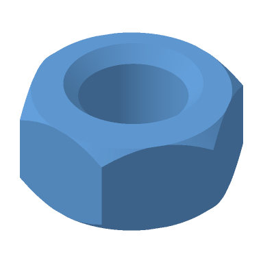
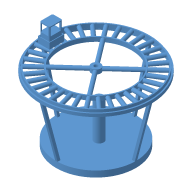

# Native Autodesk geometry renders

These PNGs were rendered by the actual static Linux x86_64 musl Catwalk executable with `--render-geometry --size 384 --transparent --samples 2`. The command bypasses embedded previews. Each input is an unchanged native producer document, with original license and pinned source attribution retained in the repository.

| Fusion part · `.f3d` | Fusion part · `.f3d` |
| :---: | :---: |
|  |  |
| Samuel Oladosu's Toy Block | Samuel Oladosu's Hex Nut; cosmetic threads are not reconstructed |
| **Inventor part · `.ipt`** | **Inventor assembly · `.iam`** |
|  |  |
| Conveyor box part | Four resolved native parts with authored assembly placements |

Fusion sources and licensing: [Toy Block notice](fusion-toy-block-NOTICE.txt), [Hex Nut notice](fusion-hex-nut-NOTICE.txt) and the [author's original README](FUSION-SAMPLES-README.md). The Inventor conveyor images retain the [original MIT license](LICENSE-roshbeng.txt). Original Inventor documents, companions, source hashes and independent export measurements: [fixture provenance](../../tests/fixtures/native_geometry/inventor/README.md).

These images demonstrate the retained native geometry subset. They do not establish compatibility with every Inventor or Fusion release, design history or assembly feature. See the [format coverage](../format-coverage.md#autodesk-inventor) for explicit limits and refused variants.
