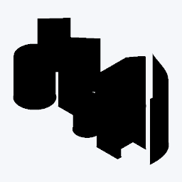
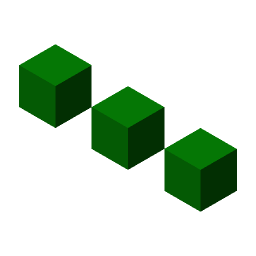
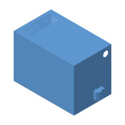

# Native geometry thumbnail examples

These examples are rendered from native model geometry with `--render-geometry --size 256 --samples 2`. Saved thumbnails do not supply their pixels. Five images use `--transparent` and match the committed native geometry snapshot baselines. The Rhino example uses `--background f5f7fa` so its native black object colors remain visible in dark previews. Geometry is checked against the original producer files and independent geometry witnesses.

| SketchUp · `.skp` | Rhino · `.3dm` |
| :---: | :---: |
|  |  |
| Shared definitions, nonuniform scale and mirroring, saved by SketchUp Web 26.2.0 | Original Rhino 5 extrusion objects and their stored profiles |
| **3ds Max · `.max`** | **SolidWorks part · `.sldprt`** |
|  |  |
| Three authored occurrences of a shared native Box primitive | Native 290 × 200 × 230 mm solid block |
| **Legacy SketchUp · `.skp`** | **SolidWorks assembly · `.sldasm`** |
|  |  |
| Original SketchUp 2017 face with an open hole | Nine placed occurrences from seven supplied native parts; 13,074 triangles |

Source inputs and geometry witnesses:

- SketchUp: `2026-instance-scaled.skp` and `2017-face-with-hole.skp` from the pinned OpenSKP producer corpus. [Original files, hashes, license and independent COLLADA measurements](../../tests/fixtures/formats/sketchup/README.md). The authored geometry and these derived previews retain the corpus's [GPL-3.0-only terms](SKETCHUP-LICENSE-GPL-3.0.txt); bundled Trimble content remains separately attributed in its [original notice](SKETCHUP-CORPUS-NOTICE.md).
- Rhino: original McNeel `v5_extrusions.3dm`. [Original source and independent SDK witnesses](../../tests/fixtures/formats/rhino/README.md). The original source and derived preview retain McNeel attribution, the [original notice](RHINO-LICENSE-openNURBS.txt) and [redistribution permission](RHINO-LICENSE-permission.txt).
- 3ds Max: original BabylonJS `Instances.max`. [Producer export and pinned source hashes](../../tests/fixtures/native_geometry/max/README.md). The source and derived preview retain [Apache-2.0 terms](MAX-LICENSE-Apache-2.0.md) and attribution.
- SolidWorks: original GuoXiong Power-Package part and assembly. [Source hashes, seven native companions, independent dimensions and placements](../../tests/fixtures/formats/solidworks/README.md). The source and derived previews retain the [original MIT notice](SOLIDWORKS-LICENSE-MIT.txt).

These examples cover the supported native subsets. [Format coverage](../format-coverage.md) records tested versions, supported geometry and limits.
