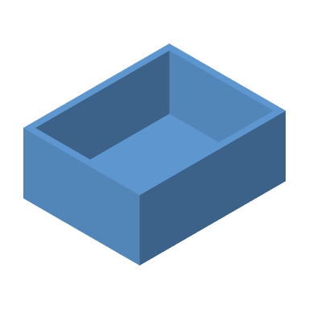

# Original Inventor geometry qualification

These are unchanged native Inventor part and assembly documents supplied by
two independent public projects. They contain real CFB/RSe databases, typed
ASM solved bodies and native assembly reference/placement records. They are
not image-only property-set carriers or Inventor envelopes constructed by
Catwalk's fixture generator.

`provenance.json` pins the repository revision, original path, Git blob, byte
length and SHA-256 of every retained input and independent reference. The
original MIT license texts are retained as `LICENSE-roshbeng.txt` and
`LICENSE-EPFL.txt`.

| Input | Source and geometry |
| --- | --- |
| `conveyor/*.ipt` and `conveyor/conveyor_model.iam` | [roshbeng/opcua_fusion_test_servers_and_hardware](https://github.com/roshbeng/opcua_fusion_test_servers_and_hardware/tree/d9ab21ced0a26e09a213a218249ac1938340bae6/CAD%20models/conveyor_model): four native parts and their original assembly. |
| `references/conveyor_model.step` | The same author's independent export of the complete conveyor. OpenCascade reports four solids and 137 faces. |
| `motor/*.ipt` and `motor/AXI 2204 Multicopter.iam` | [lis-epfl/iisr](https://github.com/lis-epfl/iisr/tree/master/CAD/Motor_AXI_220454_GOLD_LINE_V2): two native motor parts and their real assembly, including non-identity rotation and translation. |
| `mount/Motor Mount v2.ipt` and `references/Motor Mount v2.stl` | The same EPFL project's original native mount and separately exported STL. The STL contains 7,772 triangles. |

`reference-metrics.json` records the author's original STEP and STL hashes and
independent measurements from OpenCascade 7.8.1.1 and the binary STL bytes.
The STEP has bounds of approximately `(-14.7, -89.7, -112)` through
`(164.7, 89.7, 30.500000224)` millimetres and volume
`206427.88139078757 mm³`. The STL's authored bounds are approximately
`(0, -3.99949646, -12.49798584)` through `(20, 20.99949646, 12.5)` in its source
coordinates; STL itself declares no units.

`tests/inventor_geometry.rs` checks all original hashes, positive native part
geometry, the whole conveyor against the independent STEP bounds, volume and
surface area, and each of its four native parts against the corresponding
solid measured directly from that same STEP. Mass and area comparisons retain
a 2% tessellation allowance for each individual part, so errors in separate
parts cannot cancel in an assembly total. These expectations come from the
producer's original export evaluated independently with OpenCascade; the tests
do not generate the expected geometry with Catwalk's native decoder or use
Catwalk's ordinary STEP importer as the reference mesh. The separately published
`pick v2.step` is a different-height revision and is not used as this oracle.

The tests also compare
the mount against its independent STL, and the motor's literal native
placements. Geometry thumbnails are compared with renders of the imported
triangles. Missing companions, reference cycles and escaped symlinks are
negative controls in isolated copies, and image-only carriers must fail fresh
geometry rendering.

`motor-bottom-torus-oracle.json` retains independent geometric constraints from
the original Motor Bottom document: native ASM face 896 links through native
face key 3673 to the original `PmGraphicsFace` bounds of `±5.5 mm, z=6..8 mm`.
Those source bounds select the inner lower quarter of its signed-radius torus;
the analytic circular-torus area is `83.43290718326459 mm²`. Its adjoining solid
shaft and upward floor require outward radial and upward normals at the two
joints. The real-source regression checks the trim, area and triangle winding
separately, so selecting a complementary patch or reversing the quarter cannot
pass through aggregate volume cancellation. These are geometry records and
analytic constraints; no saved image contributes to the oracle.

Inventor assemblies persist machine-specific Windows paths. The original
files retain those strings unchanged. Catwalk resolves their filenames only
against supplied local siblings, keeps native instance transforms and
suppression, and refuses missing or ambiguous companions. These tests qualify
stored solved geometry and saved occurrence placements; they do not replay
Inventor features or establish compatibility with every release or Model State.
An assembly with nonempty local `AmBRep` result geometry is rejected, so its
assembly features cannot be silently omitted while rendering the referenced parts.
